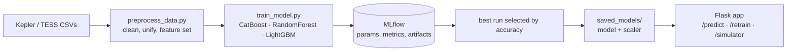

# ExoForge AI

**Exoplanet candidate classification, with an MLOps pipeline behind it.**

Built for the NASA Space Apps Challenge 2025 with **Team House Stark** — awarded **Best Mission Concept**.
Model comparison: [`model_performance/`](model_performance)

ExoForge classifies Kepler and TESS signals into three classes — **confirmed exoplanet**, **candidate**, **false positive** — and exposes the model through a Flask dashboard with what-if parameter editing, a live confidence breakdown and an interactive 3D planetary view.

The point of the project is not the classifier. It is the pipeline around it: every experiment is tracked in MLflow, the best run is selected programmatically, and the model the app serves is the one the pipeline chose — not the one someone remembered to copy into a folder.

---

## Results

Three model families were trained on the same preprocessed Kepler/TESS feature set and evaluated on a held-out split of **4,031 signals** (75/25, stratified).

| Model | Accuracy | Macro F1 | Confirmed-class F1 |
|---|---:|---:|---:|
| **CatBoost** (selected) | **0.765** | 0.77 | 0.77 |
| Random Forest | 0.758 | 0.76 | 0.74 |
| LightGBM | 0.753 | 0.75 | 0.75 |

Per-class reports and confusion matrices are in [`model_performance/`](model_performance). These are research-demo results on the bundled dataset, not a claim of production transit vetting.

## Pipeline



`run_pipeline.py` executes preprocessing and training in order. Training logs each model as a nested MLflow run, then queries MLflow for the highest-accuracy run and exports its artifacts.

## What the app does

- **Predict** (`POST /predict`) — accepts ten physical features in a fixed order, returns the class and a probability for each of the three classes.
- **What-if analysis** — load a real candidate preset, edit parameters, and re-score without retraining.
- **Retrain** (`POST /retrain`) — re-fits CatBoost with user-supplied `iterations`, `learning_rate` and `depth`, reports the new holdout accuracy, and replaces the served model.
- **3D system view** — a Three.js scene (`galaxy/Animation.html`) with planet textures and classification tags.
- **Model status** (`GET /status`) — recomputes holdout accuracy from the current model and data split.

## Repository layout

```text
exoforge/
├── app.py                  # Flask API + page routes
├── preprocess_data.py      # raw CSV → processed_combined.csv
├── train_model.py          # multi-model training + MLflow logging
├── run_pipeline.py         # one-command pipeline
├── data/                   # raw and processed datasets
├── model_performance/      # classification reports + confusion matrices
├── saved_models/           # exported model and scaler
├── static/ templates/      # dashboard UI
└── galaxy/                 # Three.js simulator
```

## Run locally

**Requirements:** Python 3.9+, Java not required, ~2 GB disk for dependencies.

```bash
git clone https://github.com/Soumaditya777/exoforge.git
cd exoforge

python3 -m venv .venv
source .venv/bin/activate          # Windows: .venv\Scripts\activate
pip install -r requirements.txt
```

**1. Reproduce the pipeline** (preprocess → train → log → select best model):

```bash
python run_pipeline.py
```

This rewrites `data/processed_combined.csv` and `saved_models/`, and creates `mlruns/`.

**2. Inspect the experiments:**

```bash
mlflow ui --port 5001
# open http://127.0.0.1:5001
```

**3. Serve the app:**

```bash
python app.py
# open http://127.0.0.1:5000
```

If a model is missing, `/predict` returns a 500 with an explicit load error — run the pipeline first.

## Data and features

Inputs combine Kepler cumulative, K2 and TESS Objects of Interest tables into `processed_combined.csv`. The model consumes:

`period`, `duration`, `depth`, `planet_radius`, `equilibrium_temp`, `insolation_flux`, `model_snr`, `stellar_temp`, `stellar_logg`, `stellar_radius`

The feature order is fixed in `app.py` because the exported scaler and model expect it. Class mapping: `0 = false positive`, `1 = candidate`, `2 = confirmed`.

## Limitations

- **Research demo, not a vetting system.** 76% accuracy on a bundled, imbalanced dataset is not sufficient for scientific use, and the splits are not grouped by target to prevent leakage across related signals.
- **No authentication or rate limiting.** `/retrain` mutates the served model, so the app should not be exposed publicly as-is.
- `app.run(debug=True)` is for local development only.
- The dataset and model artifacts are committed for reproducibility; in a production pipeline they belong in object storage or a model registry.
- The 3D simulator is illustrative, not a physical simulation.

## License

MIT — see [`LICENSE`](LICENSE). Dataset credit belongs to NASA's Kepler, K2 and TESS missions.
